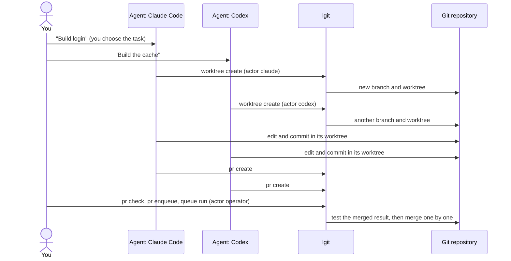
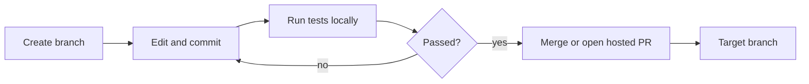
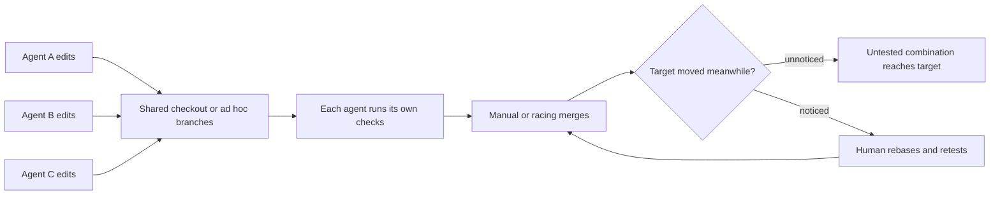
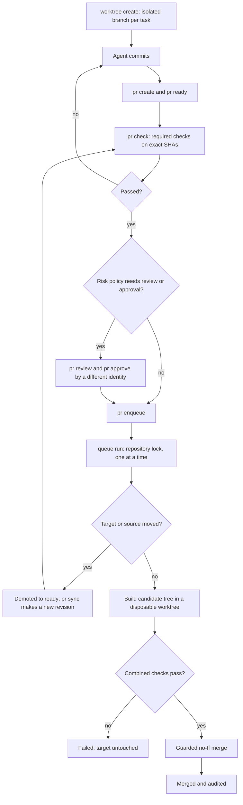

# LPRM: Local Pull Request Manager

LPRM is a local-first command-line tool that gives coding agents and humans a pull-request workflow
without a Git host. Each agent works in an isolated Git worktree, proposes a local PR, passes
deterministic validation and optional review, and merges to the target branch (`dev` by default)
only through a serialized coordinator. Nothing needs a network, a remote, a daemon, or an API key.

## Quick install

```sh
curl -fsSL https://github.com/dawamr/lprm-lgit/releases/latest/download/install.sh | sh
lgit --version
```

No Rust needed, only Git 2.38 or newer. It installs a checksum-verified binary into `~/.local/bin`
(macOS ARM64 and Intel, Linux x86-64, Linux ARM64). Run it again to update. Add `--with-skills` after `sh -s --`
to also install the agent skills. More options: [docs/install.md](docs/install.md).

## What you get

- Isolated task worktrees created from the exact SHA of `dev`.
- Local PRs with immutable revisions, exact-SHA diffs, and an audit journal.
- Required checks, conflict preflight, and a check on the combined merged tree before integration.
- Protected-path risk, separate-approver rules, and an optional external reviewer.
- A durable merge queue, a repository lock, and guarded `--no-ff` merges.
- Recovery after crashes at any point, without duplicate merges.
- Machine-readable JSON with stable exit codes, so agents never parse prose.

## The mental model (read this first)

`lgit` is a **rule keeper, not a worker and not a manager**. It never starts an agent, never assigns
a task, and never writes code. It gives whoever does the work a safe place to do it (a worktree) and
a gate that decides what may reach `dev`.

| | Who or what | Example |
| --- | --- | --- |
| Decides which task goes to whom | You, or a lead agent | "Claude Code does login, Codex does the cache" |
| Does the work and writes code | The agent (its own compute and model) | Claude Code editing files in its worktree |
| Keeps work apart, checks it, orders merges, records it | `lgit` | `worktree create`, `pr check`, `queue run`, `audit` |
| A name on the record, such as `--actor codex` | A plain label, not a login and not a process | Shows who owns a worktree and who approved |

### A concrete example

You want two features, login and a cache, built in parallel. You open two terminals, one with
Claude Code and one with Codex, and a third for yourself as the coordinator.

```sh
# Terminal 1, Claude Code was told: "build login using lgit"
lgit --actor claude worktree create --task "login"
# ...Claude edits and commits inside the printed path...
lgit --actor claude pr create --from <branch> --title "Add login"

# Terminal 2, Codex was told: "build the cache using lgit"
lgit --actor codex worktree create --task "cache"
lgit --actor codex pr create --from <branch> --title "Add cache"

# Terminal 3, you as the coordinator: check each PR, then merge them one at a time
lgit --actor operator pr ready <pr-id>
lgit --actor operator pr check <pr-id>
lgit --actor operator pr enqueue <pr-id>
lgit --actor operator queue run --all
```

What happened: `lgit` created two separate worktrees, so the agents could not overwrite each other.
It recorded that `claude` owns the login worktree and `codex` owns the cache one. It tested each PR
on its exact commits, then merged them one after another, re-testing the second against the result
of the first. The labels `claude`, `codex`, and `operator` did nothing except appear in the record.



Things `lgit` does **not** do: launch Claude Code or Codex, split a big goal into tasks, decide which
agent is better, or prove that `--actor codex` was really Codex. If you want something that
dispatches tasks automatically, that is a separate orchestrator layer on top (a lead agent or a
script) that calls the same `lgit` commands.

## Requirements

- macOS or Linux, Git 2.38 or newer (needs `git merge-tree --write-tree`).
- Rust 1.89 or newer only if you build from source. SQLite is bundled.

## Install

See [Quick install](#quick-install) above. Options, checksums, and release archives are in
[docs/install.md](docs/install.md).

## Build from source

```sh
cargo build --release --locked
install -m 0755 target/release/lgit /usr/local/bin/lgit
lgit doctor
```

Release archives and checksums are described in [docs/install.md](docs/install.md).

## Five-minute tour

```sh
lgit init --target dev
lgit --actor codex worktree create --task "add greeting"
# ...commit inside the printed worktree path, then:
lgit --actor codex pr create --from <branch> --title "Add greeting"
lgit --actor validator pr ready <pr-id>
lgit --actor validator pr check <pr-id>
lgit --actor coordinator pr enqueue <pr-id>
lgit --actor merger queue run --once
```

Add `--json` to any command for the stable machine envelope. See [docs/cli-contract.md](docs/cli-contract.md)
for every command, and [docs/agent-workflows.md](docs/agent-workflows.md) for agent flows (Codex, Hermes, Claude Code, OpenCode, or a human).

## How it compares

These tools work at different layers, so the table is about fit, not a ranking. Git is the storage and history layer. Pando and Scion are server-side source control that OpenAI and Anthropic built for their own monorepos and the volume of agent changes they produce. LPRM (`lgit`) is a small local workflow on top of ordinary Git for one machine.

| | Plain Git | Pando (OpenAI) | Scion (Anthropic) | LPRM (`lgit`) |
| --- | --- | --- | --- | --- |
| What it is | Distributed version control | Rebuilt Git server backend for OpenAI's monorepo | In-house version control system for Anthropic's monorepo | Local PR, check, and merge-queue workflow over Git |
| Git compatibility | Native | Keeps the Git client and protocol; replaces the server | Diverges from Git's model and protocols | Uses stock Git; no custom server or format |
| Where the work happens | Local clone | Server side, behind a Git front end | Server side; commits, merges, and rebases are made on the server and no push step is needed | Local worktrees, one SQLite state directory per repository |
| Agent isolation | Manual (`git worktree`, branches) | Aimed at many agents pushing to one shared repository | Clients are always-online agents and jobs, often with no local repository | One managed worktree and branch per task, with an owner |
| Review and merge gating | None; relies on a host or process | Not described as part of it | Not included; code review, search, and CI are separate systems | Immutable PR revisions, required checks, risk policy, approvals, and a serialized merge queue with candidate-tree checks |
| Audit trail | Reflog and commit history | Not described | Not described | Append-only audit journal with actor attribution |
| Scale target | Single repository | Reported around 1 PB of Git data a day, with lower push latency | Tens of thousands of merged changes a day | A handful of agents on one machine |
| Availability | Open source | Internal to OpenAI; not available to run | Internal to Anthropic; no public release announced | Open source in this repository |

What this means in practice:

- LPRM does not replace Git, and it does not try to scale a monorepo. It adds the missing local gate: nothing reaches the target branch until its exact revision has passed checks on the merged result.
- Pando and Scion address a different bottleneck, which is server throughput and checkout cost at very large scale. You can't adopt either one today, and a single machine with a few agents is unlikely to need them.
- Plain Git on its own is enough for one person. LPRM starts to pay off when several agents or sessions change the same repository and you want evidence-based merges and recovery after a crash.

The Pando and Scion rows summarize public write-ups of internal systems, not hands-on use. See OpenAI's [Scaling Git at OpenAI](https://openai.com/index/scaling-git-at-openai/) and Anthropic's [Redesigning source control at Anthropic](https://www.anthropic.com/research/redesigning-source-control). Where a cell says "not described", the sources do not cover it, which is not the same as the feature being absent.

### Workflow comparison

Three ways to get a change into the target branch. The table is about where the safety comes from, and the diagrams show the path a change takes.

| | One person with Git | Agents without LPRM | Agents with LPRM |
| --- | --- | --- | --- |
| Who changes the repository | One person, one change at a time | Several agents or sessions at once | Several agents, each in its own managed worktree |
| Isolation | The person's own working copy | Often a shared checkout or hand-made branches | One worktree and branch per task, with an owner |
| What gets validated | Whatever the person ran locally | Whatever each agent chose to run | Required checks against an exact source SHA and target SHA |
| After the target moves | The person notices and rebases | Easily missed; the old result is trusted | Queued work is demoted to `ready`; `pr sync` creates a fresh revision |
| What gets tested before merge | The branch on its own | The branch on its own | The merged candidate tree, in a disposable worktree |
| Review and approval | Self review or a hosted PR | Ad hoc, or none | Risk policy, required reviews, approvals by a different identity |
| Merge | A manual `git merge` or a button on a host | Whoever finishes first, possibly in parallel | One serialized queue under a repository lock |
| After a crash | The person inspects it | Often unclear what state was left | Recovery classifies attempts from Git evidence and never merges twice |
| Record of what happened | Commit history and reflog | Scattered chat and logs | Append-only audit journal with actor names |
| Cost | Lowest | Low until agents collide | Setup, `lgit` commands, and check time |

For one person, the first column is enough. LPRM's value shows up in the third column, when parallel agents make "what was actually tested" and "who merged what" hard to answer.

**One person with Git**



**Agents without LPRM**



**Agents with LPRM**



## Documentation

| Document | Purpose |
| --- | --- |
| [docs/install.md](docs/install.md) | Release archives, checksums, building from source |
| [docs/cli-contract.md](docs/cli-contract.md) | Commands, JSON envelope, exit codes, events |
| [docs/architecture.md](docs/architecture.md) | Crates, state machine, merge sequence, data model |
| [docs/threat-model.md](docs/threat-model.md) | Trust boundaries and what LPRM does not protect |
| [docs/runbook.md](docs/runbook.md) | Operating, recovering, and troubleshooting |
| [docs/agent-workflows.md](docs/agent-workflows.md) | End-to-end agent examples: Codex, Hermes, Claude Code, OpenCode |
| [docs/skills.md](docs/skills.md) | Installable agent skills (`scripts/install-skills.sh`) |
| [docs/examples/lprm.sample.toml](docs/examples/lprm.sample.toml) | Annotated sample configuration |
| [docs/adr](docs/adr) | Architecture decisions |
| [PRD_v1.0.md](PRD_v1.0.md) | Product requirements |

## Safety in one paragraph

LPRM cooperates with agents; it does not sandbox them. Anyone who can write to the same `.git`
directory can bypass it, identities are self-declared, and check commands run arbitrary code from
the repository. Read [docs/threat-model.md](docs/threat-model.md) before pointing it at untrusted
agents.

## Development

```sh
cargo fmt --all -- --check
cargo clippy --workspace --all-targets -- -D warnings
cargo test --workspace --locked
```

The suite creates temporary repositories and needs no network. Task status lives in
[tasks/todo.md](tasks/todo.md).
